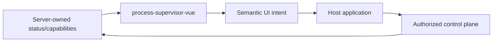

# @simone-bianco/process-supervisor-vue

Reusable Vue 3 presentation components for Process Supervisor status and lifecycle controls.

This package is deliberately framework-neutral. It does **not** import Laravel, Inertia, Ziggy, application HTTP helpers, authentication state or Python code.

## Install

When published to npm:

```bash
npm install @simone-bianco/process-supervisor-vue
```

Until publication:

```bash
npm install github:simone-bianco/process-supervisor-vue
```

The published/GitHub artifact is self-contained: the required UI primitives, UI core helpers and icons are bundled into `dist`. `vue` is the only peer dependency so the host application supplies one shared Vue runtime.

Import the package stylesheet once in the host application:

```ts
import "@simone-bianco/process-supervisor-vue/style.css";
```

No separately published `@simone-bianco/vue-ui-components`, `@simone-bianco/vue-ui-core` or `lucide-vue-next` dependency is required by consumers.

## What the package renders

The public exports currently include:

- `SupervisorOverview`
- `SupervisorStatusBanner`
- `ProcessGroupCard`
- `ProcessInstanceTable`
- presentation helpers and TypeScript status/group/instance types

The UI displays semantic runtime states and emits semantic intents such as Start, Stop, Restart and Probe. The host owns the actual transport and revalidation.



## What the package deliberately does not do

It does not:

- call HTTP endpoints
- know route names
- mutate Settings
- scale Queue or edit Scheduler cron configuration
- persist or display raw process output tails
- decide authorization
- decide whether recovery is safe

Configuration belongs in the host Settings UI. Operational capability flags come from the server projection.

## Recovery-safe controls

During recovery the host may still expose a recovery-safe Stop operation while Start/Restart/Probe remain blocked. The package therefore respects per-action capability flags instead of globally disabling all controls just because the runtime is in recovery.

## Security boundary

Runtime text is rendered as text, not injected HTML. The package expects sanitized/allowlisted server projections and does not accept executable commands, argv, environment values or filesystem paths from UI fields.

## Documentation

- [`z-docs/integration.md`](z-docs/integration.md)
- [`z-docs/architecture.md`](z-docs/architecture.md)