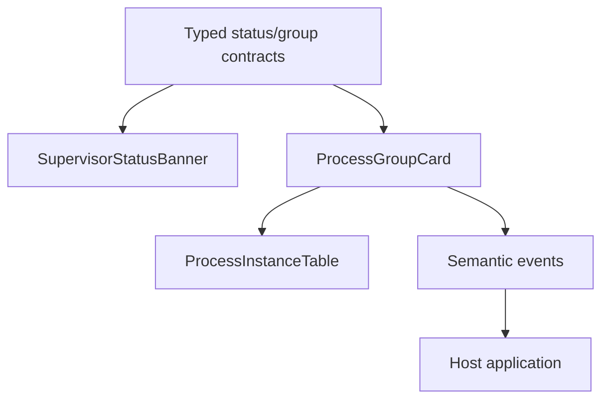
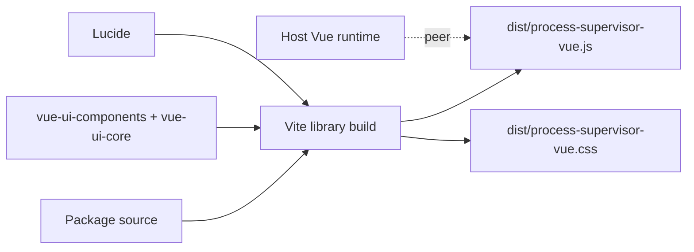

# Vue package architecture

`process-supervisor-vue` has one job: turn a server-owned Process Supervisor projection into reusable UI.

## Presentation authority

The package does not recompute operational truth. Examples:

- `can_start` comes from the server
- `can_stop` comes from the server
- `can_probe` comes from the server
- recovery summary/reason comes from the server

The package maps those values to labels, badges and disabled/enabled controls.

## Dependency model

The distributable package is built as a self-contained `dist` artifact. UI components, UI core helpers, icons and their small utility dependencies are bundled into the package JavaScript/CSS at build time.

`vue` is the only runtime peer dependency because a component library should share the host application’s Vue instance rather than install a private second runtime.

Local monorepo development resolves the source UI packages through sibling workspaces. Consumers do not need those unpublished repositories because the built artifacts are committed/published with `process-supervisor-vue`.

## Product boundary

Configuration forms are intentionally outside this package. Queue capacity ceilings, Scheduler cron and Reverb settings belong to the host’s Settings/configuration experience. This package remains operational/presentation-only.