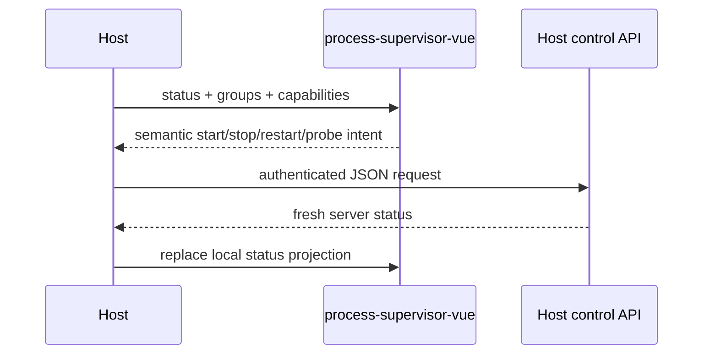

# Vue integration

The package is designed as a pure presentation layer.

## Typical host flow



The package does not know how the API call is made. A host can use Inertia, fetch, Axios or another transport.

Import the standalone stylesheet once in the consumer entrypoint:

```ts
import "@simone-bianco/process-supervisor-vue/style.css";
```

The stylesheet and JavaScript bundle already contain the package's UI primitive/core/icon implementation. Only Vue is resolved from the host application.

## Example

```vue
<script setup lang="ts">
import { ProcessGroupCard } from '@simone-bianco/process-supervisor-vue'

const props = defineProps<{ group: ProcessGroupView }>()
const emit = defineEmits<{
  start: [groupId: string]
  stop: [groupId: string]
  restart: [groupId: string]
  probe: [groupId: string]
}>()
</script>

<template>
  <ProcessGroupCard
    :group="props.group"
    @start="emit('start', $event)"
    @stop="emit('stop', $event)"
    @restart="emit('restart', $event)"
    @probe="emit('probe', $event)"
  />
</template>
```

The server-provided capability flags remain authoritative. Do not infer permissions only from visual state.

## Polling

Polling belongs to the host application because only the host knows page visibility, transport and current tab. Local GPT polls operational tabs without performing navigation/page reloads.

## No output-tail surface

The former Output/tail surface has been removed. Operator history belongs in Diagnostics rather than in a second raw process-output UI.